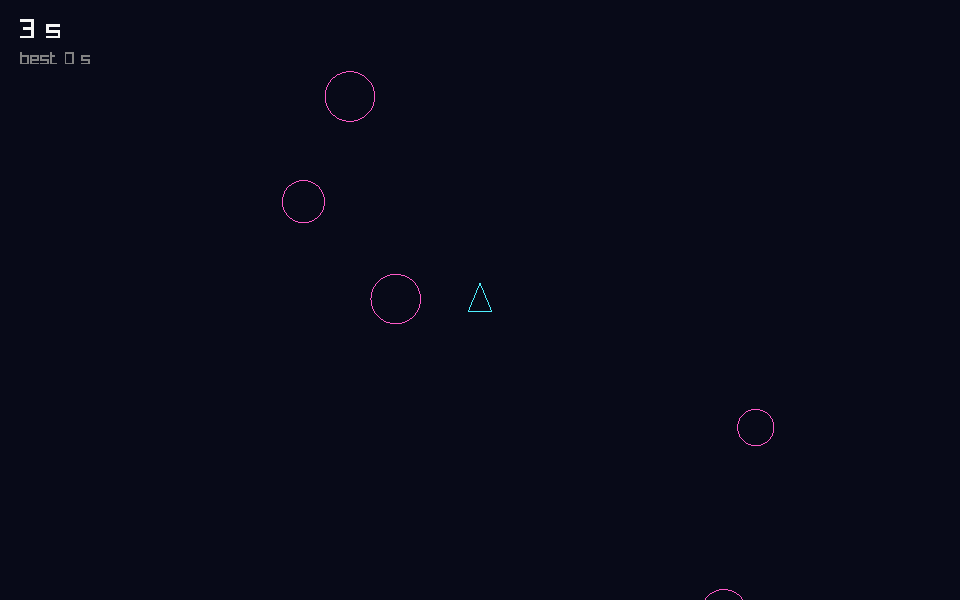
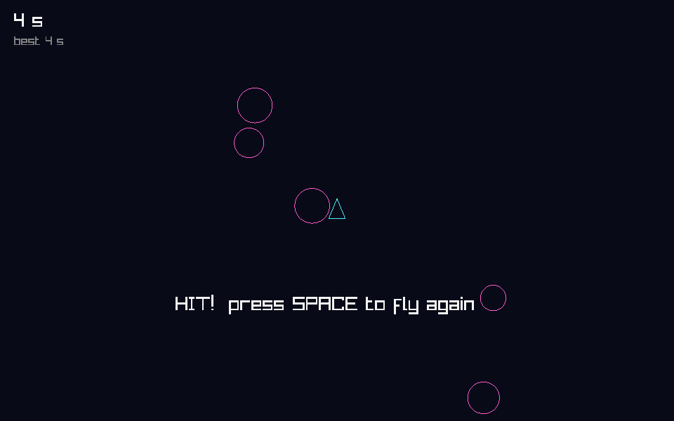

# Making a game from scratch in With using raylib

We just shipped **WIPE: SURVIVAL**, a twin-stick survivor in the spirit of
Geometry Wars and Vampire Survivors: neon wireframes, two thousand enemies,
bloom, a soundtrack, controllers, and a Steam Deck build. It is written in
[With](https://github.com/withlang-dev/with) on top of
[raylib](https://www.raylib.com/), with no C of our own anywhere in the tree.

This post walks through the same process on a game small enough to type in
over a coffee. **Drift** is a ship that dodges rocks drifting in from the
edges of the screen. It is about 150 lines, and every step below is code
you can build and run. At the end are the lessons that only showed up at
WIPE's size.



## 1. A project with raylib in it

You need the With compiler on your `PATH` (see the With README). Then:

```sh
with init drift
cd drift
with get c.raylib
```

`with init` scaffolds a project:
- `with.toml`, the package description;
- `build.w`, the build, itself written in With, with a `drift` executable
  built from `src/main.w`;
- a test, an acceptance scenario, and a git repository.

`with get` picks the newest raylib, downloads a prebuilt copy for your
platform into `.with/deps/`, pins it in `.with/lock.json`, and records the
version in `with.toml`:

```toml
[deps]
c.raylib = "6.0"
```

There is no binding library to install. With reads C headers directly.

## 2. A window

Replace the scaffold's `src/main.w` with this:

```with
use c_import("raylib.h")

const WIDTH = 960
const HEIGHT = 600

fn main:
    InitWindow(WIDTH, HEIGHT, "Drift")
    defer: CloseWindow()
    SetTargetFPS(60)
    while not WindowShouldClose():
        BeginDrawing()
        ClearBackground(BLACK)
        DrawText("Hello from With", 340, 280, 32, RAYWHITE)
        EndDrawing()
```

Build it and run it:

```sh
with build && ./out/bin/drift
```

A few things already deserve a look:

- **`use c_import("raylib.h")` is the whole binding.** The compiler parses
  raylib's header with its own built-in clang and turns every function,
  struct, enum and constant into With declarations. `InitWindow`, `BLACK`
  and `RAYWHITE` are raylib's own names.
- **`defer: CloseWindow()`** runs when `main` returns, however it returns.
  Resources are released by scope; nothing has to be remembered at the
  bottom of the function.
- **`DrawText` takes a With `str`.** The import knows the parameter is a C
  string and converts at the call.

## 3. A little vector math

Games are mostly arithmetic on 2D points, and raylib already has a type for
them: `Vector2`, two `f32`s. We use it everywhere, so there's nothing to
convert when drawing. raylib's C header doesn't give us `+` on it, so we
write the four helpers we need:

```with
fn add(a: Vector2, b: Vector2) -> Vector2: Vector2 { x: a.x + b.x, y: a.y + b.y }
fn sub(a: Vector2, b: Vector2) -> Vector2: Vector2 { x: a.x - b.x, y: a.y - b.y }
fn scale(a: Vector2, k: f32) -> Vector2: Vector2 { x: a.x * k, y: a.y * k }
fn length(a: Vector2) -> f32: sqrt(a.x * a.x + a.y * a.y)
fn clamp(v: f32, lo: f32, hi: f32) -> f32: if v < lo: lo else if v > hi: hi else: v
```

## 4. The game state, kept apart from raylib

This is the most important decision in the whole program: **the simulation
never calls raylib.** It holds the state and changes it by rules, and
nothing more. Drawing and input are separate functions that read it.

```with
type Rock { pos = Vector2 { x: 0.0, y: 0.0 }, vel = Vector2 { x: 0.0, y: 0.0 }, radius = 10.0 }
impl Copy for Rock

type Game {
    ship = Vector2 { x: 480.0, y: 300.0 },
    rocks: Vec[Rock],
    // Time is counted in whole steps, never summed from fractions.
    ticks = 0,
    best = 0,
    next_rock = 0.5,
    alive = true,
    seed = 2463534242u32,
}

fn Game.new() -> Game: Game { rocks: Vec.new() }
```

`impl Copy for Rock` makes a `Rock` an ordinary value: assigning it copies
it, like an `int`. Small plain-data types should be `Copy`; everything else
in With moves by default. Fields can have defaults, so `Game.new()` only
names the one field without a default.

Notice `ticks`. The game's clock is a count of steps, and
`seconds()` divides when someone asks. Adding 1/120 to a float every step
would slowly drift, because each addition rounds a little, and a
20-minute run would end almost a second off. A count is exact for any
run length. Methods live in an `extend` block. A method that changes
the game takes `mut self: Self`, and the caller's `game` is changed in
place. There is no `&mut`, because With doesn't have one.

## 5. Exact time, and randomness you can replay

```with
    // Seconds survived, exact at any length: a count of fixed steps.
    fn seconds(self: &Self) -> f32: self.ticks as f32 / STEPS_PER_SECOND as f32

    // xorshift32: the same seed plays the same game.
    fn random(mut self: Self) -> f32:
        self.seed = self.seed ^ (self.seed << 13)
        self.seed = self.seed ^ (self.seed >> 17)
        self.seed = self.seed ^ (self.seed << 5)
        // The top 24 bits fill an f32's mantissa exactly: a value in [0, 1).
        (self.seed >> 8) as f32 / 16777216.0
```

A seeded xorshift instead of the platform's random numbers means the same
seed plays the same game. That sounds like a nicety until the day a player
hits a crash at minute 17 (section 10).

## 6. Rocks

Each rock enters from a random edge, aimed somewhere near the middle, and
gets a little faster the longer you survive:

```with
    // A rock enters from a random edge, aimed at the middle of the field,
    // a little faster every second the ship survives.
    fn spawn_rock(mut self: Self):
        let side = (self.random() * 4.0) as i32
        let along = self.random()
        let start = match side:
            0 => Vector2 { x: -30.0, y: along * HEIGHT as f32 }
            1 => Vector2 { x: WIDTH as f32 + 30.0, y: along * HEIGHT as f32 }
            2 => Vector2 { x: along * WIDTH as f32, y: -30.0 }
            _ => Vector2 { x: along * WIDTH as f32, y: HEIGHT as f32 + 30.0 }
        let target = Vector2 { x: WIDTH as f32 * (0.25 + 0.5 * self.random()), y: HEIGHT as f32 * (0.25 + 0.5 * self.random()) }
        let heading = sub(target, start)
        let speed = 120.0 + 6.0 * self.seconds()
        let radius = 10.0 + 18.0 * self.random()
        self.rocks.push(Rock { pos: start, vel: scale(heading, speed / length(heading)), radius })
```

`match` is an expression, so `start` is just the value of whichever arm
matched. `Rock { pos: start, vel: ..., radius }` uses field shorthand: a
local named like the field fills it.

## 7. One step of the world

```with
    // One fixed step of 1/120 s. `steer` is the player's input, each axis -1..1.
    fn step(mut self: Self, steer: Vector2):
        if not self.alive: return
        self.ticks += 1
        let moved = add(self.ship, scale(steer, SHIP_SPEED * STEP))
        self.ship = Vector2 { x: clamp(moved.x, SHIP_RADIUS, WIDTH as f32 - SHIP_RADIUS), y: clamp(moved.y, SHIP_RADIUS, HEIGHT as f32 - SHIP_RADIUS) }
        self.next_rock -= STEP
        if self.next_rock <= 0.0:
            self.spawn_rock()
            self.next_rock = 0.9 / (1.0 + self.seconds() / 20.0)
        var i = 0
        while i < self.rocks.len() as i32:
            let rock = self.rocks[i]
            let pos = add(rock.pos, scale(rock.vel, STEP))
            if length(sub(pos, self.ship)) < rock.radius + SHIP_RADIUS:
                self.alive = false
                if self.ticks > self.best: self.best = self.ticks
            let gone = pos.x < -80.0 or pos.x > WIDTH as f32 + 80.0 or pos.y < -80.0 or pos.y > HEIGHT as f32 + 80.0
            if gone:
                // Swap removal: the last rock takes this slot. No allocation.
                self.rocks[i] = self.rocks[self.rocks.len() as i32 - 1]
                let _ = self.rocks.pop()
            else:
                self.rocks[i].pos = pos
                i += 1
```

Two details here are With-specific and worth understanding:

- **`let rock = self.rocks[i]` is a view, not a copy.** It looks at the
  rock where it sits in the list. A view can't stay alive across a write
  to the list it looks into, but a view lives only until its last use, and
  every use of `rock` comes before we write to `self.rocks`. So there is no
  copy, and no annotation to ask for one.
- **Swap removal.** A rock that leaves the screen is overwritten by the
  last rock, and the list shrinks by one. The list never reallocates once
  it has grown, so the step allocates nothing. In WIPE, every pool of
  enemies, bullets and particles works this way.

## 8. Input and drawing: the only code that talks to raylib

```with
fn read_steer() -> Vector2:
    var steer = Vector2 {}
    if IsKeyDown(KEY_LEFT) or IsKeyDown(KEY_A): steer.x -= 1.0
    if IsKeyDown(KEY_RIGHT) or IsKeyDown(KEY_D): steer.x += 1.0
    if IsKeyDown(KEY_UP) or IsKeyDown(KEY_W): steer.y -= 1.0
    if IsKeyDown(KEY_DOWN) or IsKeyDown(KEY_S): steer.y += 1.0
    // Diagonals are no faster than straight lines.
    let n = length(steer)
    if n > 1.0: scale(steer, 1.0 / n) else: steer
```

```with
fn draw(g: &Game):
    BeginDrawing()
    ClearBackground(Color { r: 8, g: 10, b: 24, a: 255 })
    for rock in g.rocks:
        DrawCircleLinesV((rock.pos), rock.radius as f32, Color { r: 255, g: 90, b: 200, a: 255 })
    let tip = add(g.ship, Vector2 { y: -SHIP_RADIUS * 1.4 })
    let left = add(g.ship, Vector2 { x: -SHIP_RADIUS, y: SHIP_RADIUS })
    let right = add(g.ship, Vector2 { x: SHIP_RADIUS, y: SHIP_RADIUS })
    let cyan = Color { r: 80, g: 240, b: 255, a: 255 }
    DrawTriangleLines((tip), (left), (right), cyan)
    DrawText(f"{g.ticks / STEPS_PER_SECOND} s", 20, 16, 28, RAYWHITE)
    DrawText(f"best {g.best / STEPS_PER_SECOND} s", 20, 50, 18, GRAY)
    if not g.alive:
        DrawText("HIT!  press SPACE to fly again", 250, 420, 28, RAYWHITE)
    EndDrawing()
```

`draw` takes `g: &Game`, a read-only borrow: it can look and can't touch.
The `for rock in g.rocks` loop walks the rocks in place without copying the
list.

## 9. A fixed-step main loop

```with
fn main:
    InitWindow(WIDTH, HEIGHT, "Drift")
    defer: CloseWindow()
    SetTargetFPS(60)
    var game = Game.new()
    var pending = 0.0
    while not WindowShouldClose():
        if not game.alive and IsKeyPressed(KEY_SPACE): game.restart()
        // Fixed steps: bank the frame's time, spend it 1/120 s at a time.
        pending += clamp(GetFrameTime(), 0.0, 0.1)
        let steer = read_steer()
        while pending >= STEP:
            game.step(steer)
            pending -= STEP
        draw(&game)
```

The frame rate decides how often we *draw*. It doesn't decide how the
world *moves*. Each frame banks the time that passed, and the simulation
spends it in exact steps of 1/120 s. Each step adds one to `ticks`, and
that count is the game's clock. A 144 Hz monitor, a 60 Hz Steam Deck
and a hitching laptop all play the same game. The clamp to 0.1 s keeps one
long frame (a window drag, a laptop waking from sleep) from fast-forwarding
the world.

Build it, run it, and you have a game:

```sh
with build && ./out/bin/drift
```



## The whole program

```with
use c_import("raylib.h")

const WIDTH = 960
const HEIGHT = 600
// The simulation advances in fixed steps, whatever the frame rate.
const STEPS_PER_SECOND = 120
const STEP = 1.0 / 120.0
const SHIP_RADIUS = 12.0
const SHIP_SPEED = 320.0

// ----- a little vector math, on raylib's own Vector2 -------------------------

fn add(a: Vector2, b: Vector2) -> Vector2: Vector2 { x: a.x + b.x, y: a.y + b.y }
fn sub(a: Vector2, b: Vector2) -> Vector2: Vector2 { x: a.x - b.x, y: a.y - b.y }
fn scale(a: Vector2, k: f32) -> Vector2: Vector2 { x: a.x * k, y: a.y * k }
fn length(a: Vector2) -> f32: sqrt(a.x * a.x + a.y * a.y)
fn clamp(v: f32, lo: f32, hi: f32) -> f32: if v < lo: lo else if v > hi: hi else: v

// ----- the simulation: no window, no drawing ---------------------------------

type Rock { pos = Vector2 { x: 0.0, y: 0.0 }, vel = Vector2 { x: 0.0, y: 0.0 }, radius = 10.0 }
impl Copy for Rock

type Game {
    ship = Vector2 { x: 480.0, y: 300.0 },
    rocks: Vec[Rock],
    // Time is counted in whole steps, never summed from fractions.
    ticks = 0,
    best = 0,
    next_rock = 0.5,
    alive = true,
    seed = 2463534242u32,
}

fn Game.new() -> Game: Game { rocks: Vec.new() }

extend Game:
    // Seconds survived, exact at any length: a count of fixed steps.
    fn seconds(self: &Self) -> f32: self.ticks as f32 / STEPS_PER_SECOND as f32

    // xorshift32: the same seed plays the same game.
    fn random(mut self: Self) -> f32:
        self.seed = self.seed ^ (self.seed << 13)
        self.seed = self.seed ^ (self.seed >> 17)
        self.seed = self.seed ^ (self.seed << 5)
        // The top 24 bits fill an f32's mantissa exactly: a value in [0, 1).
        (self.seed >> 8) as f32 / 16777216.0

    // A rock enters from a random edge, aimed at the middle of the field,
    // a little faster every second the ship survives.
    fn spawn_rock(mut self: Self):
        let side = (self.random() * 4.0) as i32
        let along = self.random()
        let start = match side:
            0 => Vector2 { x: -30.0, y: along * HEIGHT as f32 }
            1 => Vector2 { x: WIDTH as f32 + 30.0, y: along * HEIGHT as f32 }
            2 => Vector2 { x: along * WIDTH as f32, y: -30.0 }
            _ => Vector2 { x: along * WIDTH as f32, y: HEIGHT as f32 + 30.0 }
        let target = Vector2 { x: WIDTH as f32 * (0.25 + 0.5 * self.random()), y: HEIGHT as f32 * (0.25 + 0.5 * self.random()) }
        let heading = sub(target, start)
        let speed = 120.0 + 6.0 * self.seconds()
        let radius = 10.0 + 18.0 * self.random()
        self.rocks.push(Rock { pos: start, vel: scale(heading, speed / length(heading)), radius })

    fn restart(mut self: Self):
        self.ship = Vector2 { x: WIDTH as f32 / 2.0, y: HEIGHT as f32 / 2.0 }
        while self.rocks.len() > 0: let _ = self.rocks.pop()
        self.ticks = 0
        self.next_rock = 0.5
        self.alive = true

    // One fixed step of 1/120 s. `steer` is the player's input, each axis -1..1.
    fn step(mut self: Self, steer: Vector2):
        if not self.alive: return
        self.ticks += 1
        let moved = add(self.ship, scale(steer, SHIP_SPEED * STEP))
        self.ship = Vector2 { x: clamp(moved.x, SHIP_RADIUS, WIDTH as f32 - SHIP_RADIUS), y: clamp(moved.y, SHIP_RADIUS, HEIGHT as f32 - SHIP_RADIUS) }
        self.next_rock -= STEP
        if self.next_rock <= 0.0:
            self.spawn_rock()
            self.next_rock = 0.9 / (1.0 + self.seconds() / 20.0)
        var i = 0
        while i < self.rocks.len() as i32:
            let rock = self.rocks[i]
            let pos = add(rock.pos, scale(rock.vel, STEP))
            if length(sub(pos, self.ship)) < rock.radius + SHIP_RADIUS:
                self.alive = false
                if self.ticks > self.best: self.best = self.ticks
            let gone = pos.x < -80.0 or pos.x > WIDTH as f32 + 80.0 or pos.y < -80.0 or pos.y > HEIGHT as f32 + 80.0
            if gone:
                // Swap removal: the last rock takes this slot. No allocation.
                self.rocks[i] = self.rocks[self.rocks.len() as i32 - 1]
                let _ = self.rocks.pop()
            else:
                self.rocks[i].pos = pos
                i += 1

// ----- input and drawing: the only code that talks to raylib ----------------

fn read_steer() -> Vector2:
    var steer = Vector2 {}
    if IsKeyDown(KEY_LEFT) or IsKeyDown(KEY_A): steer.x -= 1.0
    if IsKeyDown(KEY_RIGHT) or IsKeyDown(KEY_D): steer.x += 1.0
    if IsKeyDown(KEY_UP) or IsKeyDown(KEY_W): steer.y -= 1.0
    if IsKeyDown(KEY_DOWN) or IsKeyDown(KEY_S): steer.y += 1.0
    // Diagonals are no faster than straight lines.
    let n = length(steer)
    if n > 1.0: scale(steer, 1.0 / n) else: steer

fn draw(g: &Game):
    BeginDrawing()
    ClearBackground(Color { r: 8, g: 10, b: 24, a: 255 })
    for rock in g.rocks:
        DrawCircleLinesV((rock.pos), rock.radius as f32, Color { r: 255, g: 90, b: 200, a: 255 })
    let tip = add(g.ship, Vector2 { y: -SHIP_RADIUS * 1.4 })
    let left = add(g.ship, Vector2 { x: -SHIP_RADIUS, y: SHIP_RADIUS })
    let right = add(g.ship, Vector2 { x: SHIP_RADIUS, y: SHIP_RADIUS })
    let cyan = Color { r: 80, g: 240, b: 255, a: 255 }
    DrawTriangleLines((tip), (left), (right), cyan)
    DrawText(f"{g.ticks / STEPS_PER_SECOND} s", 20, 16, 28, RAYWHITE)
    DrawText(f"best {g.best / STEPS_PER_SECOND} s", 20, 50, 18, GRAY)
    if not g.alive:
        DrawText("HIT!  press SPACE to fly again", 250, 420, 28, RAYWHITE)
    EndDrawing()

fn main:
    InitWindow(WIDTH, HEIGHT, "Drift")
    defer: CloseWindow()
    SetTargetFPS(60)
    var game = Game.new()
    var pending = 0.0
    while not WindowShouldClose():
        if not game.alive and IsKeyPressed(KEY_SPACE): game.restart()
        // Fixed steps: bank the frame's time, spend it 1/120 s at a time.
        pending += clamp(GetFrameTime(), 0.0, 0.1)
        let steer = read_steer()
        while pending >= STEP:
            game.step(steer)
            pending -= STEP
        draw(&game)
```

## 10. What WIPE taught us at scale

Drift is a toy, but its shape is the shape of WIPE, a 10,000-line game.
Here's what held up, and what we learned the hard way.

**Keep the simulation pure, and everything else gets easy.** WIPE's
`game.w` has no window, audio or foreign calls. Because of that, the same
simulation runs:
- in the real game;
- under a scripted bot that plays full runs and checks invariants every
  frame;
- in a benchmark that fills the arena with 1,800 enemies;
- in balance tools that measure every weapon's kill rate;
- in a tour that screenshots every screen for review.

None of that needs a human, and most of it doesn't even need a window.

**Count time, don't sum it.** WIPE's first clock was a float that added
1/120 every step, under a 20-minute timeline with bosses due at minutes 5,
10 and 15. A step count, with seconds derived from it, is exact at any
length, and it's what WIPE uses now.

**Make the game replayable.** Fixed steps plus a seeded RNG plus quantized
input (we round every input to 1/4096 before the simulation sees it)
means a run is fully described by its seed and its inputs. WIPE writes a
small recording of every run. "I crashed at 17:04" became "here is the
file", and a `runs replay` tool replays every recording exactly or
reports where it diverged.

**Allocate up front.** Pools sized at start, swap removal, and a uniform
grid for "what's near me" queries mean WIPE's frame loop allocates
nothing. Its stress test, 1,800 enemies plus sustained particles,
measures the game, not the allocator.

**Let C stay C, but give it an owner.** raylib's
`GetApplicationDirectory` returns a pointer into a static buffer that the
next call overwrites. With's `c facade` lets you state that once, beside
the import, and the compiler then refuses code that keeps the borrowed
string too long:

```with
c facade paths:
    domain directory process
    fn GetApplicationDirectory
        returns borrow CStr from domain directory
```

**Fail loudly.** A missing shader or sound file makes WIPE print what is
missing and exit. raylib quietly falls back to its default shader when
one fails to load, so WIPE's renderer checks that every uniform it
expects exists before the first frame. A broken effect can't pass for a
working one.

**Separate settings from progress.** Volume and fullscreen live in
`settings.txt`, and unlocks live in the save. The save is the file Steam
Cloud carries between a Steam Deck and a desktop, so it holds only what
belongs to the player; what belongs to the machine stays on the
machine.

**Treat the screen's shape as part of the game.** WIPE renders a 1280×800
view, the Deck's panel, and widens or heightens it to the screen's aspect
ratio, so nothing is stretched or letterboxed. Because the view decides
where enemies spawn, its size is recorded with each run so replays stay
exact.

**Ask the hardware, don't guess.** Valve's controllers have a "lizard
mode" that moves the mouse when no software claims them. Under Steam,
Steam Input handles it. Outside Steam, WIPE does what SDL does and turns
it off itself. Our first version guessed whether Steam was in charge and
guessed wrong on a direct launch. The fix was to ask SDL which device it
actually sees: Steam's virtual gamepad means Steam owns the controller.

**Expect the language to move under you, and let it.** With changed twice
during WIPE: once with the view rule from section 7, and once when
fields became reachable by bare name inside their own methods, so a local
named `ship` in a method of a type with a `ship` field became an error.
Both times the compiler named every site and suggested the fix, and the
code came out clearer.

## Where to go next

- **Add a gamepad.** raylib's `IsGamepadAvailable` and
  `GetGamepadAxisMovement` slot into `read_steer` in a few lines. (WIPE uses
  SDL3 beside raylib for controllers, for wider hardware support.)
- **Add juice.** A screen shake, a particle burst on a hit, and a
  `RenderTexture2D` with a blur shader for bloom: that's most of WIPE's
  look.
- **Add a test.** Because `Game` never touches raylib, a test can create
  one, call `step` a thousand times with a fixed seed, and assert where the
  ship ended up.
